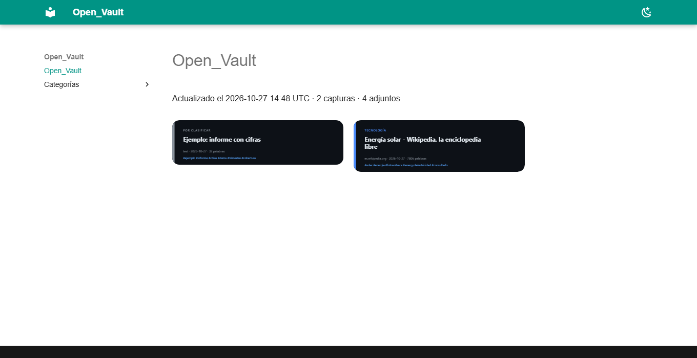
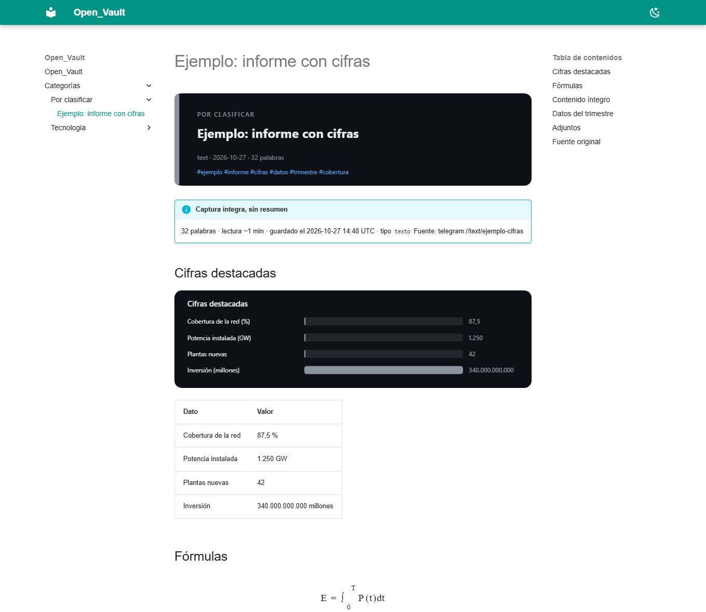
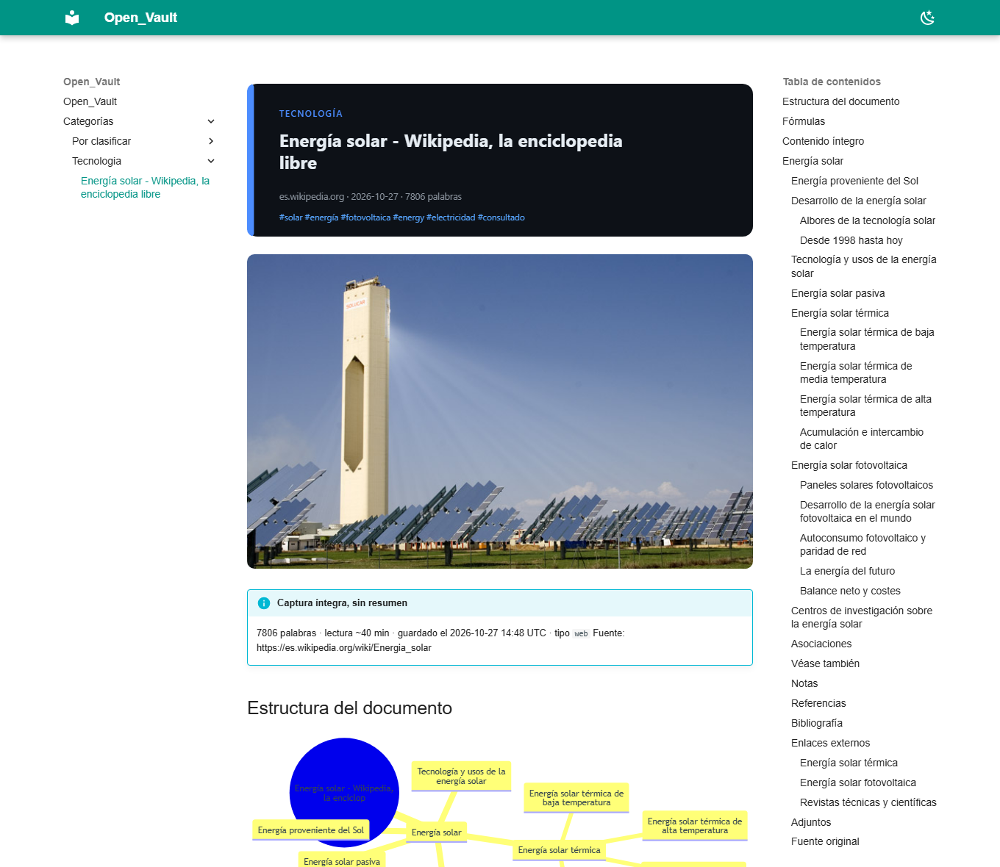

# Open_Vault

Captura privada, por Telegram, a un vault de Obsidian: mandás un texto, un link,
una imagen o un video, y queda guardado como una nota Markdown **enriquecida**
(con ficha visual, gráficos, diagramas y fórmulas) que se lee de un vistazo.

Todo el procesamiento pasa en tu propia máquina. **No hay servicios de resumen,
no hay costo por uso y no hay API key obligatoria.**

[](https://github.com/iaioflc4-hub/Open_Vault/actions/workflows/pruebas.yml)


## Qué genera

Cada captura se convierte en una nota con esta forma:

```
![[Attachments/2026-10-27-informe-solar-9f2ab31c4d-ficha.svg]]

> [!info] Captura íntegra, sin resumen
> 1.240 palabras · lectura ~7 min · guardado el 2026-10-27 14:02 UTC · tipo `web`

## Estructura del documento
（diagrama Mermaid con los encabezados reales del texto）

## Cifras destacadas
![[Attachments/2026-10-27-informe-solar-9f2ab31c4d-cifras.svg]]
| Dato | Valor |
| --- | --- |
| Cobertura | 87,5 % |

## Fórmulas
$$ E = mc^2 $$

## Contenido íntegro
（el texto completo, tal como se extrajo）

## Adjuntos
![[Attachments/web-4b1c9e0a2f.jpg]]

## Fuente original
https://ejemplo.org/informe
```

De dónde sale cada cosa, sin inventar nada:

| Entrada | Qué se guarda |
| --- | --- |
| Texto suelto | Nota con etiquetas, métricas y estructura |
| Link de una web | Texto principal íntegro (trafilatura), imagen principal, estructura del documento |
| Imagen | El original embebido + el texto extraído con OCR (Tesseract local) |
| Video (archivo) | El original local + una miniatura sacada con ffmpeg |
| Video (link) | La referencia, por dominio, sin subir el archivo a ningún lado |

La **ficha SVG** y el **gráfico de barras** se generan a mano con la librería
estándar de Python: sin dependencias, sin servicios, y el resultado se ve igual
en Obsidian, en un navegador y en la vista previa de GitHub. Las fórmulas van en
LaTeX y los diagramas en Mermaid, que Obsidian ya sabe dibujar: por eso no hace
falta instalar nada parecido a TeX.

## Cómo funciona

```
  Telegram (tú)                     tu servidor                    tu vault
  ─────────────                     ───────────                    ────────
  texto ─┐
  link  ─┤   long polling      ┌──────────────────┐          ┌────────────────────┐
  foto  ─┼──────────────▶  ───▶│ Open_Vault (py)  │ ───────▶ │ Obsidian / Logseq  │
  video ─┘   (sin webhook,      │ + tesseract      │  Markdown│ / Foam / git       │
              sin puertos)      │ + ffmpeg         │  + SVG   └────────────────────┘
                                └──────────────────┘
```

Una sola pieza de software. A propósito **no** usa n8n ni IFTTT: cada servicio
extra que se suma es otro lugar donde se puede romper la privacidad, otra cosa
que mantener y otra cosa que hay que replicar para copiar el proyecto.

## Leer las capturas

### En Obsidian (el camino recomendado)

Las notas son Markdown común, así que Obsidian las abre tal cual. Un comando trae
las capturas del servidor a tu carpeta local, las guarda en git y las sube:

```bash
bash visor/sincronizar.sh          # una corrida: trae, guarda en git y sube
bash visor/automatico.sh           # deja corriendo: busca capturas nuevas cada 60 s
```

En Windows: doble clic en `visor\sincronizar.cmd` para una corrida, o en
`visor\automatico.cmd` para que se actualice solo. Con el modo automático **no hace
falta cerrar y abrir Obsidian**: las notas que le mandás al bot aparecen solas,
porque el sync las baja cada minuto. La ventana se puede minimizar y se corta con
Ctrl+C.

La carpeta se detecta sola entre las habituales (`~/Obsidian/Open_Vault`,
`~/Documents/Open_Vault`, `~/Open_Vault`); si tu copia está en otro lado, pasala:

```bash
OBSIDIAN_VAULT="$HOME/Documents/Open_Vault" bash visor/sincronizar.sh
```

Después, en Obsidian: **Abrir carpeta como vault** y elegís esa carpeta. Ya está:
búsqueda, enlaces, imágenes y fórmulas funcionando sobre archivos comunes. El
comando hace un commit por corrida, así que queda el historial de qué llegó y
cuándo.

Del otro lado, el servidor corre su propio temporizador cada 5 minutos:
reclasifica las notas con las reglas del día, vuelve a tejer los enlaces del
gráfico y sube los cambios a GitHub. Los dos caminos se juntan: el servidor sube,
tu computadora trae y sube lo que edites a mano (antes de subir hace un
`pull --rebase`, y si el servidor subió algo en el medio, reintenta una vez).

Cuando una captura cambia de tema, el servidor la mueve de carpeta. Tu copia no se
queda con las dos: borra la vieja, pero **solo** dentro de `Categorías/`, `Temas/`,
`Attachments/` y el mapa. Tus archivos y la configuración de Obsidian
(`.obsidian/`) no se tocan nunca, y el `.git` del servidor tampoco viaja: cada
máquina tiene el suyo.

#### Para leerlo en el celular

El plugin **Git** de Obsidian hace lo mismo que el script: clonás el repo una vez
y hacés *Pull* cuando quieras. Una sola vez, en tu computadora:

```bash
gh repo create MiUsuario/Open_Vault-notas --private     # o creálo desde la web
git -C ~/Obsidian/Open_Vault remote add origin https://github.com/MiUsuario/Open_Vault-notas.git
bash visor/sincronizar.sh                                # trae y sube
```

Si el push pide credenciales, alcanza con tener `gh` autenticado
(`gh auth login`): git usa su credencial y no hay que pegar ningún token.

Y en el celular: Obsidian + plugin Git, clonás ese repo privado (con un token de
GitHub que solo pueda leerlo) y hacés *Pull*. Después de cada
`sincronizar.cmd` en la computadora, un *Pull* en el celular y lo tenés al día.

Si no querés instalar nada en el celular, el mismo repo privado se lee desde el
navegador: GitHub abre las notas y las imágenes, y dibuja los diagramas Mermaid.

### Vista web (opcional)



Si preferís una web —o querés mostrar el vault a alguien sin darle acceso al
repo— se genera un sitio estático con **MkDocs Material** (libre, con búsqueda,
Mermaid y matemática). No hay un servicio nuevo escuchando: son archivos HTML que
sirve el nginx que ya tengas, y un temporizador de systemd los regenera cada 5
minutos —solo si el vault cambió—.





Lo único propio es el traductor entre el Markdown de Obsidian y el del generador:
adjuntos embebidos (`![[Attachments/x.svg]]`), wikilinks, callouts (`> [!info]`)
y fórmulas. Mermaid y MathJax quedan dentro del repo, así que la vista funciona
sin depender de ningún CDN y sin pedirle nada a terceros (tampoco tipografías).

#### La vista web en tu computadora (sin publicar nada)

```bash
bash visor/leer.sh          # Linux, macOS o Git Bash en Windows
```

En Windows: doble clic en `visor/leer.cmd`. Trae su propia copia del vault (no
toca la de Obsidian), arma la vista y la abre en `http://localhost:8000`.
Nada sale a internet: el servidor escucha solo en `127.0.0.1` y con Ctrl+C se
apaga. No necesita nginx, ni dominio, ni puertos abiertos.

Los dos comandos comparten las mismas variables: `SERVIDOR` (host de tu
`~/.ssh/config`), `PUERTO`, `BASE` (estado y copia de la web) y `PYTHON`.

Variables útiles: `SERVIDOR` (host de tu `~/.ssh/config`), `PUERTO`, `BASE`
(dónde guardar la copia) y `PYTHON` (para usar el entorno del proyecto).

#### Dónde se acumula cada cosa

Todo vive en una sola carpeta de Markdown (`VAULT_PATH`, por defecto
`/srv/obsidian/Open_Vault`):

| Qué | Dónde | Peso típico |
| --- | --- | --- |
| Lo que mandaste (crudo) | `Attachments/telegram-<id>.<ext>` | el original tal cual: una foto ronda 200 KB |
| Lo procesado | `Categorías/<categoría>/<fecha>-<título>-<hash>.md` | 25-40 KB por nota |
| Lo visual generado | `Attachments/*-ficha.svg`, `*-cifras.svg`, `*-miniatura.jpg` | 5-30 KB cada uno |

Nada se guarda por duplicado: si mandás dos veces la misma fuente se reescribe la
misma nota, porque el hash de la fuente va en el nombre del archivo. Los cuadros
que se leen de un video son temporales: al vault solo va el texto, no las imágenes.

Si no querés que esto ocupe disco en el servidor, traelo y vacialo en un paso:

```bash
bash visor/sincronizar.sh --mover     # baja a Obsidian, verifica con md5 y borra
bash visor/leer.sh --mover           # lo mismo, para la copia de la web
```

El orden importa: primero baja, después compara el hash de cada archivo con el
del servidor y **solo borra lo que quedó idéntico**. Si la copia se corta a mitad
de camino, no borra nada. Tu copia local acumula todo, así que el servidor queda
en cero y seguís viendo el histórico completo. La otra opción, si querés no
depender del servidor para nada, es correr el bot en tu propia computadora con
`VAULT_PATH` apuntando a una carpeta local.

### En el servidor (opcional)

```bash
sudo APP_DIR=/opt/openvault bash install.sh      # instala también la vista web
sudo bash install.sh --sin-visor                 # solo el bot
/opt/openvault/.venv-visor/bin/python -m open_vault.visor --forzar   # regenerar ahora
```

El temporizador deja el sitio en `/var/www/openvault-web` (configurable con
`VISOR_SALIDA`). Que lo publique un servidor web o no es decisión tuya: es una
carpeta de HTML estático con **rutas relativas**, así que funciona igual en la
raíz de un dominio o dentro de una subcarpeta, y también abriendo el
`index.html` desde el disco.

## Requisitos

- Linux con Python 3.11 o superior (probado en Debian 13).
- Un token de bot de Telegram (gratis, con [@BotFather](https://t.me/BotFather)).
- Opcional: `tesseract-ocr` para el OCR, `ffmpeg` para las miniaturas y los
  cuadros del video, `poppler-utils` para leer PDF escaneados y `faster-whisper`
  si querés transcripción. `install.sh` instala lo del sistema que falte (incluidos
  `yt-dlp` y `pypdf` para links y PDF); la transcripción va aparte, con una línea,
  porque agrega unos 350 MB de dependencias. Para YouTube conviene además un
  runtime de JavaScript (`deno`) en el servidor: sin él, yt-dlp avisa que la
  extracción queda degradada.
- Recursos medidos en el servidor de referencia (1 vCPU, 965 MB de RAM, 9.8 GB de
disco): el bot y la vista web juntos ocupan unos 200 MB de disco y el servicio
del bot queda con un techo de 300 MB de memoria. El vault crece con las
imágenes: menos de 1 MB por cada 100 capturas de texto.

## Instalación

```bash
git clone https://github.com/iaioflc4-hub/Open_Vault.git
cd Open_Vault
sudo bash install.sh
```

Después, un asistente que pregunta lo que falta y **verifica cada respuesta**
contra la API de Telegram (si el token está mal lo dice; tu ID lo lee del mensaje
que le mandás al bot, no lo copiás de ningún lado):

```bash
sudo bash configurar.sh
```

Te pide el token de @BotFather, espera tu `/id`, te pregunta si querés la
transcripción local y dónde guardar las notas, reinicia el servicio y te manda un
mensaje de prueba: si te llega, está todo conectado.

```bash
sudo bash configurar.sh --simular     # valida el token y muestra qué haría, sin tocar nada
sudo BOT_TOKEN=123:abc bash configurar.sh   # sin preguntas (instalación desatendida)
```

Si preferís hacerlo a mano, las claves son estas (el `.env` nunca se comparte ni
se versiona):

```bash
sudo nano /opt/openvault/.env      # BOT_TOKEN y ALLOWED_TELEGRAM_USER_IDS
sudo systemctl restart open-vault
```

Para probarlo en tu computadora sin servidor:

```bash
python3 -m venv .venv && . .venv/bin/activate
pip install -e .
cp .env.example .env && nano .env   # BOT_TOKEN, tu ID y VAULT_PATH local
python -m open_vault.bot
```

### Activar la transcripción local (opcional)

Transcribe el audio de los videos **en la misma máquina**: nada se sube a ningún
servicio. Son dos pasos:

```bash
/opt/openvault/.venv/bin/pip install faster-whisper   # 350 MB de dependencias, una vez
```

```ini
# /opt/openvault/.env
TRANSCRIPTION_ENGINE=faster-whisper
TRANSCRIPTION_MODEL=tiny        # tiny es el más liviano; base o small mejoran la calidad
TRANSCRIPTION_LANGUAGE=es
```

Medido en el servidor de referencia (1 vCPU, 965 MB de RAM), con el modelo `tiny`:
4 segundos de audio se transcriben en **2 segundos** y el pico de memoria es de
**404 MB**. La primera vez baja el modelo (75 MB) a `TRANSCRIPTION_CACHE`.

La transcripción corre en un proceso aparte, con tiempo máximo, y el video se
guarda igual si el motor falla o tarda demasiado. Antes de arrancar se fija
cuánta memoria libre hay: si queda menos que `TRANSCRIPTION_MIN_FREE_MB` (450 MB),
no transcribe y te lo dice por Telegram, en vez de dejar sin memoria al resto de
los servicios. Mientras transcribe, el bot atiende un mensaje por vez, así que un
video largo se hace esperar.

## Configuración

Todo esto lo escribe `configurar.sh`; la tabla queda para quien quiera ajustar algo
puntual a mano.

| Variable | Por defecto | Para qué |
| --- | --- | --- |
| `BOT_TOKEN` | — | Token de @BotFather (obligatorio) |
| `ALLOWED_TELEGRAM_USER_IDS` | — | IDs autorizados, separados por coma (obligatorio) |
| `VAULT_PATH` | `/srv/obsidian/Open_Vault` | Carpeta del vault |
| `MAX_DOWNLOAD_MB` | `18` | Tamaño máximo por descarga |
| `MAX_IMAGE_MB` | `3` | Tamaño máximo de la imagen principal de una web |
| `OCR_LANGUAGE` | `spa+eng` | Idiomas de Tesseract |
| `FETCH_MAIN_IMAGE` | `true` | Bajar la imagen principal de las páginas |
| `VIDEO_THUMBNAILS` | `true` | Sacar miniatura de los videos (necesita ffmpeg) |
| `VIDEO_FRAMES` | `4` | Cuántos cuadros del video leer con OCR; `0` lo apaga |
| `TRANSCRIPTION_ENGINE` | vacío | Motor local de transcripción (`faster-whisper`); vacío = apagada |
| `TRANSCRIPTION_MODEL` | `tiny` | Modelo de Whisper: `tiny`, `base` o `small` |
| `TRANSCRIPTION_LANGUAGE` | `es` | Idioma esperado del audio |
| `YTDLP_COOKIES` | vacío | Archivo de cookies del navegador para los sitios que bloquean la IP del servidor |
| `LINK_AUDIO_MAX_SECONDS` | `1800` | Hasta qué minuto de un video se baja el audio para transcribir |
| `PDF_MAX_PAGES_TEXT` | `300` | Cuántas páginas se leen de un PDF |
| `PDF_MAX_PAGES_OCR` | `10` | Cuántas páginas se OCR-ean de un PDF escaneado |
| `VISOR_SALIDA` | `/var/www/openvault-web` | Carpeta donde se genera la vista web |
| `VISOR_BASE_URL` | vacío | URL canónica del sitio, si lo publicás en un subdominio |

## Uso

- **Texto**: guarda una nota. Si escribís algo con encabezados, cifras como
  `Cobertura: 87,5 %` o fórmulas, la nota sale enriquecida con eso.
- **Link**: guarda el texto íntegro. Si además escribís un comentario junto al
  link, queda como sección `## Comentario propio`.
- **Imagen**: guarda el original y le pega el OCR. El epígrafe que pongas en
  Telegram se usa como título.
- **Video**: si lo mandás como archivo, queda con miniatura, la duración y el
  **texto que aparece en pantalla** (OCR de unos cuadros repartidos por el video,
  que se tiran después de leerlos). Si encendés `TRANSCRIPTION_ENGINE`, se le
  suma la transcripción del audio, hecha en la misma máquina. Un **video redondo**
  o un **GIF** pasan por el mismo camino (son mp4 igual).
- **Link de video** (YouTube, Instagram, TikTok, Vimeo…): se busca el contenido de
  verdad, en este orden: subtítulos del propio video, subtítulos automáticos y, si
  no hay, el audio para transcribirlo acá. Una publicación de Instagram que no es
  video (un carrusel de fotos) igual trae título, autor y pie completo, que es con
  lo que se clasifica. Ver *YouTube desde un servidor*, más abajo.
- **PDF**: se guarda el original y se le saca el texto; si es un escaneo (sin
  texto seleccionable) se convierte cada página en imagen y se lee con OCR.
- **Audio o nota de voz**: se guarda el archivo y, con el motor de transcripción
  encendido, el texto. El audio de Telegram llega en `.oga`, así que se convierte
  con ffmpeg antes de transcribir (nada sale de la máquina).
- **`/id`**: muestra tu ID numérico de Telegram (lo usa el asistente para
  autorizarte sin que copies números).
- Después de capturar, un `sincronizar.cmd` (o el modo automático) en tu
  computadora y un *Pull* en el celular: tus notas viajan solas.

### Cómo se clasifica cada nota

La categoría sale del contenido, nunca del formato: un video no va a "Videos", va
al tema del que habla. El orden es:

1. las listas de temas de `classify.py`, con el **título pesando el triple** que el
   cuerpo — y el pie que escribís en Telegram cuenta como título;
2. una **etiqueta escrita a mano**: si mandás `#seguridad` o `#huerta-organica`,
   ese es el tema, aunque la palabra no esté en ninguna lista;
3. si no hay ninguna pista, `Por clasificar`, y el bot te lo dice para que le
   mandes una palabra o una etiqueta y lo mueva.

Cada captura se enlaza además a notas de tema (`[[Temas/seguridad]]`) y esas notas
listan lo que llegó. El `Mapa del vault.md` junta todos los temas: es la puerta de
entrada al gráfico de Obsidian. Las palabras del gráfico salen del contenido (sin
direcciones web, sin códigos de color, sin palabras de la propia plantilla), así
que el mapa conecta temas y no formatos.

### Rehacer los enlaces que quedaron pendientes

Si un link quedó sin transcripción —porque en ese momento no se pudo leer, o porque
el sitio bloqueaba la IP— no hace falta reenviarlo:

```bash
/opt/openvault/.venv/bin/python -m open_vault.rehacer --vault /srv/obsidian/Open_Vault
/opt/openvault/.venv/bin/python -m open_vault.rehacer --simular     # qué haría, sin escribir
/opt/openvault/.venv/bin/python -m open_vault.rehacer --limite 5    # solo los primeros 5
```

Vuelve a pedir el contenido, escribe lo que encuentra **en la misma nota** (sin
tocar nada de lo que ya estaba) y, si el título era la URL pelada, le pone el real.

### YouTube desde un servidor

YouTube pide "confirmá que no sos un robot" cuando la descarga viene de una IP de
servidor. Se destraba con una cookie de tu navegador:

1. Exportá las cookies de `youtube.com` con una extensión tipo *Get cookies.txt*
   (formato Netscape).
2. Copialas al servidor y cerrá los permisos:
   `sudo cp cookies.txt /etc/openvault/youtube-cookies.txt && sudo chmod 600 /etc/openvault/youtube-cookies.txt`
3. Agregá al `.env` `YTDLP_COOKIES=/etc/openvault/youtube-cookies.txt` y reiniciá:
   `sudo systemctl restart open-vault`.

Sin cookies, los links de YouTube igual quedan con su ficha real (título, canal,
descripción, miniatura) y **clasificados por ese contenido**; lo único que falta
es el texto, y la nota lo dice.

## Privacidad y límites

- El bot es privado: solo los IDs de `ALLOWED_TELEGRAM_USER_IDS` pueden capturar.
  A cualquier otro le responde que no está autorizado.
- Las URLs se validan contra SSRF: se rechazan direcciones privadas, locales o
  reservadas, y también durante cada redirección.
- Nada se resume ni se reescribe: el texto se guarda completo, tal como se extrajo.
- Nada se envía a terceros: ni el texto, ni las imágenes, ni el audio. La
  transcripción, cuando está encendida, corre en la misma máquina.
- Límites actuales: la API de bots de Telegram baja archivos de hasta 20 MB, el
  OCR puede tardar unos segundos por imagen en 1 vCPU y los videos se guardan
  completos (si no querés que ocupen disco en el servidor, usá
  `visor/leer.sh --mover`, o mandalos como link en vez de archivo).

## Pruebas

```bash
python -m unittest discover -s tests -v
```

## Compartir y replicar

El proyecto es chico a propósito: un instalador, un archivo de configuración y
una unidad de systemd. Para que otra persona lo use necesita su propio bot de
Telegram (2 minutos con @BotFather) y su propia carpeta de notas; no hay que
registrarse en ningún servicio ni pagar nada.

Si lo mejorás, un PR con el mismo criterio sirve: **menos dependencias y menos
datos afuera del vault**.

## Hacia dónde puede seguir

- Un modelo de transcripción más grande si el chico no alcanza
  (`TRANSCRIPTION_MODEL=base`), a cambio de más memoria.
- Diarización (quién habla) cuando hay más de una voz: el mismo motor la resuelve
  y todavía no se usa.
- Una cola de trabajos para videos largos: hoy el bot transcribe de a uno y, si el
  video es largo, se hace esperar.
- Etiquetado y categorización con un modelo, **opcional y con clave propia**,
  dejando intacto el funcionamiento sin IA paga.
- Segunda puerta de entrada por correo (IMAP de solo lectura) para reenviar mails.

## Proyectos parecidos (y qué se tomó de cada uno)

Esto no salió de cero: hay bastante camino hecho alrededor de Telegram y los
vaults de Markdown. Lo que se reutilizó, y lo que se evitó a propósito:

| Proyecto | Qué aporta | Qué se hizo acá |
| --- | --- | --- |
| [Paulius0112/ObsidianLinkBot](https://github.com/Paulius0112/ObsidianLinkBot) | Bot que extrae artículos de una URL a notas Markdown | Se toma la idea y se suma la parte visual, el OCR y la vista web |
| [danzansho/obsidian-voice-bot](https://github.com/danzansho/obsidian-voice-bot) | Notas de voz por Telegram con transcripción | Referencia para el día que se active la transcripción |
| [mlyxz/telegram-to-obsidian](https://github.com/mlyxz/telegram-to-obsidian) | Reenvía mensajes a la nota diaria | Muestra lo mínimo que se puede hacer; acá se prioriza el enriquecido |
| [Vault Telegram Bridge](https://community.obsidian.md/plugins/vault-telegram-bridge) y [Telegram Sync](https://www.obsidianstats.com/plugins/telegram-sync) | Capturan **dentro** de Obsidian, sin servidor | Alternativa válida si no querés VPS: la contra es que necesita Obsidian abierto |
| [Witral](https://forum.obsidian.md/t/witral-a-self-hosted-ingestion-framework-whatsapp-markdown-drive-sync-native-compatibility-with-obsidian-and-other-pkms/110425) | Framework de ingesta (WhatsApp, Drive, Markdown) | Confirma el diseño: Markdown en disco como formato neutral |
| [Quartz](https://quartz.jzhao.xyz/) | Publica un vault de Obsidian como sitio web | Descartado **acá** solo por la versión de Node del servidor (pide 22): si tenés Node 22+, es la mejor opción para publicar |
| [MkDocs Material](https://squidfunk.github.io/mkdocs-material/) | Genera el sitio: búsqueda, Mermaid, matemática | **Es el motor de la vista web**: solo se escribió el traductor de formato |
| [Copyparty](https://github.com/9001/copyparty) | Servidor de archivos con visor y contraseña | Alternativa si preferís navegar la carpeta cruda sin generar un sitio |
| [faster-whisper](https://github.com/SYSTRAN/faster-whisper) | Transcripción de audio local con el modelo Whisper, en CPU | **Es el motor de transcripción**: se envuelve, no se reescribe |
| [whisper.cpp](https://github.com/ggml-org/whisper.cpp) | El mismo Whisper en C++, para máquinas más flojas | Plan B si el servidor no da la memoria: acá el motor elegido entra en 404 MB |
| [Scriberr](https://github.com/rishikanthc/scriberr) | Suite completa de transcripción con interfaz web y diarización | Se descarta **como pieza** por peso (Svelte, FastAPI, Docker); se copia la idea de transcribir sin salir de tu máquina |
| [transcribe-anything](https://github.com/zackees/transcribe-anything) | Envoltorio multi-motor de Whisper para archivos y URLs | Referencia para probar otro motor sin tocar el código |

Criterio para el resto: nada de n8n, IFTTT ni bases de datos. Cada pieza extra es
otro lugar donde se puede romper la privacidad, otro consumo de RAM en un VPS
chico y otro paso que hay que replicar para copiar el proyecto.

## Licencia

MIT. Usalo, cambialo y publicalo con libertad.
